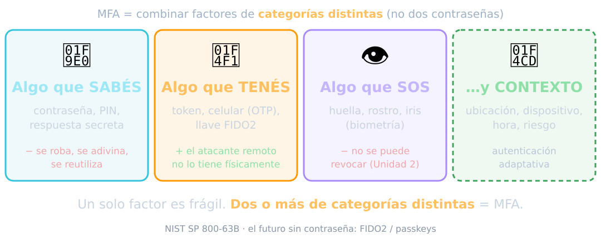
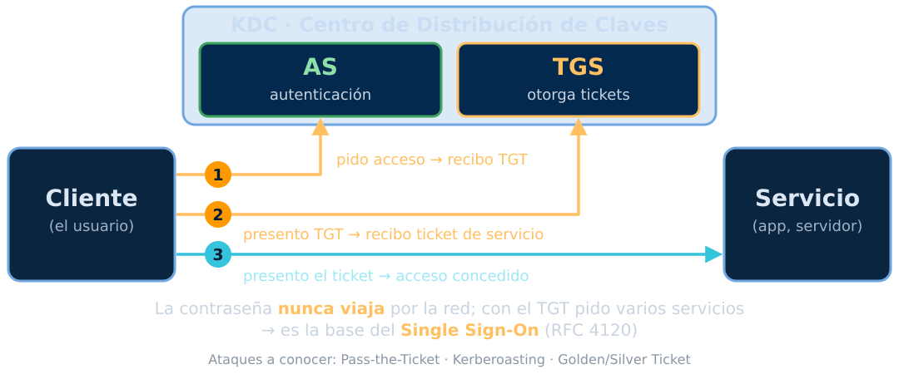
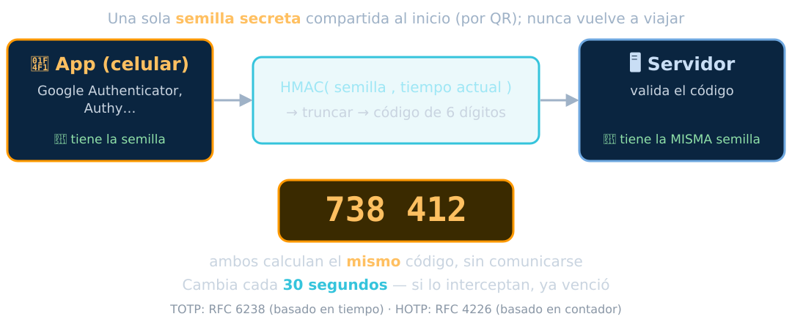

<!-- _class: portada -->
<!-- _paginate: false -->
<!-- _footer: '' -->

# Sistemas de Autenticación
## Unidad 7 — Probar quién es cada uno

ARyS · IF046 · UNPSJB Trelew · 2026

<!--
Nota del docente:
De proteger el mensaje (U6) a probar la identidad. Eje moderno: el mundo va
hacia passwordless (passkeys/FIDO2). OTP (HOTP/TOTP) es parte central de MFA.
Actualizar: NIST 800-63B-4 (2025) reemplaza a la guía de 2017.
-->

---

## De proteger el mensaje a probar quién sos

En la **Unidad 6** aprendimos a proteger la información. Pero antes de dar acceso
hay una pregunta previa:

> ¿Cómo sé que **sos quien decís ser**?

El problema
Todo el cifrado del mundo no sirve si le abrís la puerta al atacante porque
<em>se hizo pasar</em> por un usuario legítimo. La autenticación es esa puerta.

---

## AAA: tres cosas distintas

<b>Authentication</b>¿Quién sos? Probar la identidad.

<b>Authorization</b>¿Qué podés hacer? Permisos una vez dentro.

<b>Accounting</b>¿Qué hiciste? Registro y auditoría.

No confundir
Autenticar (probar identidad) ≠ autorizar (dar permisos). Podés estar autenticado
y <strong>no</strong> tener permiso para algo. Zero Trust (U5) exige verificar las
tres, siempre.

---

## Los factores de autenticación

---

## El factor más débil: la contraseña

"Algo que sabés" es lo más usado… y lo más frágil:

- Se **reutiliza** entre sitios (una fuga, muchas cuentas caídas)
- Se **adivina**, se **roba**, se **phishea**
- El humano elige contraseñas malas

Credential stuffing
Con bases de contraseñas filtradas, el atacante prueba automáticamente esas mismas
credenciales en cientos de sitios. Por eso <strong>no reutilizar</strong> es tan
importante.

---

## Cómo se guardan las contraseñas

> **Nunca** en texto plano. Si te roban la base, no deben poder leerlas.

Se guarda un **hash** (Unidad 6), pero con dos agregados:

- **Sal** única por usuario → derrota las *rainbow tables*
- **Función lenta y con costo de memoria** → encarece el crackeo offline

Las tres modernas
<strong>bcrypt</strong>, <strong>scrypt</strong> y <strong>Argon2</strong> (ganador
del Password Hashing Competition; RFC 9106, variante Argon2id por defecto). Un
SHA-256 pelado <em>no alcanza</em>: es demasiado rápido de crackear.

---

## Ataques a las contraseñas

<b>Fuerza bruta</b>Probar todas las combinaciones.

<b>Diccionario</b>Probar listas de comunes (rockyou).

<b>Rainbow tables</b>Hashes precalculados (la sal las anula).

<b>Credential stuffing</b>Reusar credenciales filtradas.

Enganche U3
El crackeo offline (John, Hashcat) lo vimos en Hacking Ético. Por eso el hash tiene
que ser <strong>lento</strong>: cada intento cuesta.

---

## Lo que hoy recomienda NIST

La guía vigente (**NIST SP 800-63B-4**, 2025) cambió el sentido común viejo:

### Sí
- **Longitud** sobre complejidad (mín. 8, hasta ≥64)
- Chequear contra listas de **comprometidas**
- Permitir gestores de contraseñas

### No
- **No** forzar reglas de composición
- **No** forzar rotación periódica sin motivo
- **No** preguntas "secretas"

Ojo
Mucho de lo que te enseñaron ("cambiala cada 90 días", "poné un símbolo") hoy está
<strong>desaconsejado</strong>. La guía cambió; el material viejo quedó atrás.

---

## Autenticación basada en tickets: Kerberos

<!--
Nota del docente (profundizar):

Idea central: Kerberos responde a "¿cómo pruebo quién soy ante MUCHOS servicios
sin mandarle mi contraseña a ninguno?". La respuesta es un tercero de confianza,
el KDC, que comparte una clave secreta con cada usuario y con cada servicio y que
reparte tickets. Todo es criptografía SIMÉTRICA (conectar con la Unidad 6).

Quién conoce qué clave (dibujarlo en el pizarrón antes de seguir el flujo):
- El KDC conoce la de TODOS: la de cada usuario (derivada de su contraseña), la de
  cada servicio y la suya propia (la cuenta krbtgt en Active Directory).
- El usuario solo conoce la suya. Cada servicio solo conoce la suya.
- Por eso un ticket cifrado con la clave de un servicio solo pudo emitirlo el KDC.

Los tres pasos del diagrama son en realidad tres intercambios de pedido y
respuesta (seis mensajes). El diagrama dibuja una sola flecha por paso para que se
lea de lejos; aclarar que cada flecha es ida y vuelta.

1) AS-REQ / AS-REP: iniciar sesión (una vez por jornada).
   El cliente dice "soy ana" y, como preautenticación, envía la hora actual
   cifrada con su clave. El AS responde con dos cosas: el TGT, cifrado con la clave
   de krbtgt (el cliente NO puede leerlo, solo guardarlo), y una clave de sesión
   cifrada con la clave del usuario. Solo quien sabe la contraseña puede abrir esa
   clave de sesión: así se prueba la identidad sin que la contraseña viaje.
   Ojo: en este paso todavía no se pide acceso a ningún servicio; el usuario
   se AUTENTICA y recibe el TGT.

2) TGS-REQ / TGS-REP: pedir un ticket para UN servicio (una vez por servicio).
   El cliente presenta el TGT, un autenticador (su nombre y la hora, cifrados con
   la clave de sesión) y el nombre del servicio que quiere (SPN). El TGS devuelve
   un ticket de servicio cifrado con la clave DE ESE SERVICIO y una nueva clave de
   sesión entre cliente y servicio. No se vuelve a pedir la contraseña.

3) AP-REQ / AP-REP: usar el servicio.
   El cliente presenta el ticket de servicio y un autenticador. El servicio abre
   el ticket con su propia clave y listo: NO consulta al KDC. Si el cliente lo
   pide, el servicio responde demostrando que pudo abrir el ticket. Esa es la
   autenticación MUTUA: el cliente también sabe que el servidor es legítimo.

Ejemplo para contar en clase: una mañana en una red con cuatro servicios.
- 08:00 Ana inicia sesión en su PC. Paso 1, una sola vez: obtiene el TGT, que en
  Active Directory dura unas 10 horas. Es la única vez que escribe la contraseña.
- 08:05 abre la intranet. Paso 2 pidiendo HTTP/intranet.empresa.local y paso 3
  contra el servidor web.
- 08:20 abre una carpeta compartida. Paso 2 pidiendo cifs/archivos.empresa.local y
  paso 3 contra el servidor de archivos.
- 09:00 manda a imprimir. Paso 2 pidiendo HOST/impresion.empresa.local y paso 3
  contra el servidor de impresión.
- 09:30 el sistema de gestión consulta la base. Paso 2 pidiendo
  MSSQLSvc/db.empresa.local:1433 (en PostgreSQL sería postgres/db.empresa.local) y
  paso 3 contra el servidor de base de datos.
- 10:00 vuelve a la intranet: el ticket del servidor web sigue en la caché, así
  que no hay ningún mensaje al KDC.

Resumen para el pizarrón: 1 TGT + N tickets de servicio. El paso 1 se hace una
vez; los pasos 2 y 3 se repiten por cada servicio nuevo. Cuatro servicios
significan una contraseña escrita, cuatro tickets y cero contraseñas de usuarios
guardadas en los servidores. Eso es el Single Sign-On. Se puede mostrar en vivo:
`klist` en Windows; `kinit` y `klist` en Linux.

Qué gana cada servidor: el web, el de archivos, el de impresión y el de base de
datos no guardan contraseñas de usuarios ni consultan al KDC en cada acceso. Solo
necesitan su propia clave (en Linux, el archivo keytab).

Kerberos AUTENTICA, no autoriza (volver a la filmina de AAA): el ticket dice
"esta es Ana"; si Ana puede leer esa carpeta o esa tabla lo decide cada servicio.
En Active Directory el ticket lleva además los grupos del usuario (el PAC) para
que el servicio pueda decidir.

Detalles que suelen preguntar:
- La hora importa. Los autenticadores llevan marca de tiempo y se rechazan si el
  reloj difiere más de 5 minutos (valor por defecto). Es la defensa contra la
  repetición de mensajes capturados (replay). Sin NTP, Kerberos deja de funcionar.
- El KDC es un punto único de falla y de compromiso. Si cae, nadie obtiene tickets
  nuevos, aunque los vigentes siguen sirviendo hasta vencer. Por eso se replica
  (varios controladores de dominio). Escucha en el puerto 88, TCP y UDP.
- Los servicios se identifican por SPN (clase/host), no por dirección IP. Por eso
  Kerberos depende de que el DNS funcione bien.

Por qué existen los ataques del pie del diagrama (nivel conceptual; se retoman en
la filmina siguiente). Todos se entienden con "quién conoce qué clave":
- Pass-the-Ticket: el ticket es al portador. Quien lo copia de un equipo
  comprometido puede usarlo hasta que venza. Defensa: vida corta de los tickets y
  proteger las estaciones de trabajo.
- Kerberoasting: el ticket de servicio va cifrado con la clave de la cuenta de
  servicio. Si esa cuenta tiene una contraseña débil, se puede adivinar fuera de
  línea. Defensa: contraseñas largas y aleatorias en las cuentas de servicio
  (cuentas administradas, gMSA) y cifrado AES en lugar de RC4.
- Silver Ticket y Golden Ticket: usan claves DISTINTAS. Con la clave de un
  servicio se falsifican tickets solo para ese servicio (Silver). Con la clave de
  krbtgt se falsifican TGT válidos para todo el dominio (Golden). Defensa: tratar
  la clave de krbtgt como el secreto más sensible del dominio y rotarla.

Para ampliar:
- RFC 4120, Kerberos V5: https://www.rfc-editor.org/rfc/rfc4120
- Documentación de MIT Kerberos: https://web.mit.edu/kerberos/krb5-latest/doc/
- Microsoft, Kerberos authentication overview:
  https://learn.microsoft.com/en-us/windows-server/security/kerberos/kerberos-authentication-overview
- "Designing an Authentication System: a Dialogue in Four Scenes" (MIT, 1988). Es
  el diálogo clásico que explica por qué el protocolo es como es:
  https://web.mit.edu/kerberos/dialogue.html
-->

---

## Por qué importa Kerberos

Es la base de la autenticación en **Active Directory** y en muchísimas redes
corporativas.

- La **contraseña nunca viaja** por la red
- Un solo login → **SSO**: el TGT sirve para pedir muchos servicios
- Tickets con **tiempo de vida** limitado

Ataques a conocer
<strong>Pass-the-Ticket</strong> (robar y reusar tickets), <strong>Kerberoasting</strong>
(crackear offline claves de cuentas de servicio), <strong>Golden Ticket</strong>
(falsificar TGT con el hash de <code>krbtgt</code>), <strong>Silver Ticket</strong>
(falsificar tickets de un servicio con el hash de su cuenta). Fuente: RFC 4120.

---

<!-- _class: portada -->
<!-- _paginate: false -->
<!-- _footer: '' -->

# Más de un factor
## MFA y contraseñas de un solo uso

Porque un solo factor no alcanza

---

## Autenticación multifactor (MFA)

> Combinar **dos o más factores de categorías distintas**.

- Contraseña **+** código del celular (algo que sabés + algo que tenés)
- Aunque te roben la contraseña, **falta el segundo factor**

La regla
Dos contraseñas <strong>no</strong> son MFA (misma categoría). Tiene que ser de
<em>tipos distintos</em>: saber + tener + ser.

---

## OTP: contraseñas de un solo uso

---

## HOTP y TOTP

### HOTP
Basado en un **contador** que avanza con cada uso.

`código = HMAC(secreto, contador)`

RFC 4226

### TOTP
Basado en el **tiempo** (ventanas de ~30 s). Es lo que usan Google Authenticator,
Authy.

`código = HMAC(secreto, tiempo)`

RFC 6238

La clave
El secreto se comparte <strong>una sola vez</strong> (por QR). Después, ambos lados
calculan el mismo código <strong>sin comunicarse</strong>. Si interceptan el código,
ya venció.

---

## OTP por SMS: mejor que nada, pero débil

Recibir el código por SMS es popular… y **problemático**:

- **SIM swapping**: el atacante secuestra tu número
- Intercepción en la red (SS7), phishing en tiempo real

Postura de NIST
En <strong>NIST SP 800-63B-4</strong>, el OTP por SMS es un <em>"restricted
authenticator"</em>: se puede usar, pero con evaluación de riesgo y plan de
migración. Preferí una <strong>app TOTP</strong> o una <strong>llave FIDO2</strong>.

---

## Cuando el segundo factor también falla

**MFA fatigue / prompt bombing**: el atacante que **ya tiene tu contraseña** dispara
decenas de notificaciones push hasta que aprobás por cansancio o error.

Caso real
Así entraron a <strong>Uber en 2022</strong>. Mitigación: <strong>number
matching</strong> (tenés que tipear un número que muestra la pantalla), límites de
tasa, y factores <strong>resistentes a phishing</strong> (FIDO2).

---

<!-- _class: portada -->
<!-- _paginate: false -->
<!-- _footer: '' -->

# El futuro sin contraseña
## FIDO2 · WebAuthn · Passkeys

La actualización que está reemplazando a la contraseña

---

## Autenticación sin contraseña

En lugar de un secreto compartido, **criptografía de clave pública** (Unidad 6):

- Tu dispositivo genera un **par de claves por sitio**
- La **privada nunca sale** del dispositivo; **firma un desafío** del servidor
- El servidor solo guarda tu **clave pública** → si lo hackean, no hay contraseñas
  que robar

Resistente a phishing por diseño
La firma está <strong>ligada al dominio</strong>: una web falsa no puede reutilizarla.
Es la diferencia estructural con la contraseña y el OTP.

---

## FIDO2 y passkeys

### FIDO2
El estándar: **WebAuthn** (API del navegador, W3C) **+ CTAP2** (dispositivo).

WebAuthn **Level 2** es la recomendación estable; Level 3 está en camino.

### Passkeys
La versión de consumo masivo: credenciales FIDO **sincronizables** por la nube
(Apple, Google, Microsoft).

Resolvió el problema de "¿y si pierdo el dispositivo?".

Por qué reemplazan a la contraseña
No se reutilizan, no se filtran del servidor, no se phishean. NIST 800-63B-4 ya las
respalda como <em>"syncable authenticators"</em>.

---

## Federación: iniciar sesión con otro

El botón "Iniciar sesión con Google/Microsoft". Tres estándares que conviene no
mezclar:

<b>OAuth 2.0</b>AUTORIZACIÓN: delegar acceso a recursos. "Qué podés hacer". RFC 6749.

<b>OpenID Connect</b>AUTENTICACIÓN sobre OAuth: agrega el ID Token. "Quién sos".

<b>SAML 2.0</b>Federación enterprise (XML), SSO corporativo. OASIS.

Error clásico
Usar <strong>OAuth "pelado" para login</strong>. OAuth es autorización, no
autenticación. Para "quién sos" va <strong>OpenID Connect</strong>.

---

## AAA de red: RADIUS y TACACS+

Para autenticar acceso a la **red** y a los **equipos** (engancha con Redes):

### RADIUS
UDP; junta autenticación y autorización. Cifra **solo la contraseña**.
Uso: Wi-Fi 802.1X, VPN. RFC 2865.

### TACACS+
Origen Cisco, TCP; cifra **todo** el paquete y **separa** las tres A.
Uso: administración de dispositivos. RFC 8907 (Informational).

---

## Hacia dónde va todo

Dos fuerzas que ya vimos, aplicadas a la identidad:

- **Passwordless**: eliminar la contraseña como secreto compartido → passkeys
- **Zero Trust** (Unidad 5): la autenticación deja de ser un evento único de login y
  pasa a ser **verificación continua y adaptativa** según el **riesgo**

Autenticación adaptativa
Si algo cambia (dispositivo nuevo, país raro, hora inusual), el sistema pide
<strong>re-autenticación</strong> (step-up). El contexto también es un factor.

---

## Cerrando la unidad

1. **AAA**: autenticar ≠ autorizar ≠ registrar
2. Factores: algo que **sabés / tenés / sos** (+ contexto); MFA los combina
3. Contraseñas: **hash + sal + función lenta** (Argon2); NIST cambió las reglas
4. **Kerberos**: SSO con tickets, sin mandar la contraseña (y sus ataques)
5. **OTP**: HOTP (contador) y TOTP (tiempo); SMS es débil
6. **Passkeys / FIDO2**: sin contraseña, clave pública, **resistente a phishing**
7. Federación: **OAuth** (autoriza) vs **OpenID Connect** (autentica) vs SAML

Próxima unidad
<strong>Unidad 8 — Herramientas de Monitoreo.</strong> Ya controlamos quién entra;
ahora, cómo <em>vigilar</em> que todo siga sano: SNMP, Syslog, gestión de red.

---

<!-- _class: portada -->
<!-- _paginate: false -->
<!-- _footer: '' -->

# ¿Preguntas?

Material: github.com/bzappellini/ARyS · Campus virtual UNPSJB

